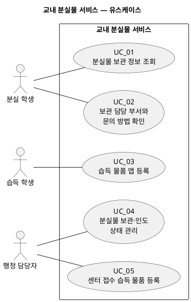

# 유스케이스 식별서 v0.1 — 교내 분실물 서비스

## 확정 사항

액터(시스템과 직접 상호작용하는 역할)는 **분실 학생, 습득 학생, 행정 담당자**의 3명이다. 유스케이스(사용자가 하나의 목표를 달성하는 서비스)는 화면·버튼·DB 저장 단계로 나누지 않는다.

| 구분 | 확정 내용 | 출처와 적용 |
| --- | --- | --- |
| 액터 | 분실 학생 / 습득 학생 / 행정 담당자 | 고객 검토 완료 지시; 원문 §2, S1·S2·S3 |
| 학생 등록 | 습득 학생이 주운 물품을 앱으로 바로 등록한다. | 고객 검토 완료 지시; FR_04, UC_03. 원문 S3만으로 등록 기능을 도출한 것은 아니다. |
| 센터 등록 | 행정 담당자가 분실물 센터에 접수된 습득 물품을 관리하려고 등록한다. | 고객 검토 완료 지시; NEEDS_2·SC2·S2; FR_07, UC_05 |
| 모델링 판단 | 학생 앱 등록과 센터 접수 등록을 별도 UC로 모델링한다(분석 결정; 고객 검토 완료 사항과 구분). | 주체·시작 상황·목표가 다름. 화면이나 저장 기능의 차이 때문이 아니다. [논의] Q_05: 입력·처리 차이가 없다면 하나의 UC에 두 액터를 연결하는 안을 재검토한다. |

기준: [고객 요구사항 원문](./고객%20요구사항.md) 및 [SRS_v0.1.md](./SRS_v0.1.md). 원문 ID의 위치와 가정 표기는 SRS의 작성 기준을 따른다.

## 액터 목록

| 액터 | 설명 | 주요 목표 | 근거 FR |
| --- | --- | --- | --- |
| 분실 학생 | 분실한 물품 정보를 확인하는 역할. | 방문 전 보관 여부·위치·문의 방법 파악 | FR_01, FR_02, FR_03, FR_06; 원문 S1·NEEDS_1·NEEDS_4 |
| 습득 학생 | 주운 물품을 앱으로 바로 등록하는 역할. | 습득 물품을 알려 반환을 위한 정보 제공 | FR_04; 고객 검토 완료 지시. 원문 S3·NEEDS_5는 맡길 장소 목표만 제시 |
| 행정 담당자 | 센터 접수 습득 물품을 등록하고 보관·인도 상태를 관리하는 역할. | 센터 물품 정보와 실제 처리 결과 관리 | FR_05, FR_06, FR_07; S2·NEEDS_2·NEEDS_3 및 고객 검토 완료 지시 |

정보보호 담당자·학생회·운영 책임자는 원문 §2의 이해관계자(요구에 의견·책임을 가진 사람)이다. 직접 시스템을 이용하는 서비스가 원문에 없고 확정 액터가 3명이므로 액터로 추가하지 않는다. 같은 학생이 상황에 따라 분실 학생과 습득 학생 역할을 맡을 수 있다.

## 유스케이스 목록

| UC ID | 유스케이스명 | 주 액터 | 사용자 목표 | 관련 FR·Pol |
| --- | --- | --- | --- | --- |
| UC_01 | 분실물 보관 정보 조회 | 분실 학생 | 방문 전 보관 여부·위치·상태를 확인해 반복 방문을 줄인다. | FR_01, FR_02, FR_06; Pol_01, Pol_02, Pol_03, Pol_04, Pol_08 |
| UC_02 | 보관 담당 부서와 문의 방법 확인 | 분실 학생 | 담당 창구와 문의 방법을 알아 올바른 부서로 문의한다. | FR_03; Pol_01, Pol_02, Pol_03, Pol_04 |
| UC_03 | 습득 물품 앱 등록 | 습득 학생 | 주운 물품을 앱으로 바로 알려 반환을 위한 정보를 제공한다. 센터 입고 완료를 의미하지 않는다. | FR_04; Pol_01, Pol_02, Pol_05, Pol_06, Pol_07 |
| UC_04 | 분실물 보관·인도 상태 관리 | 행정 담당자 | 실제 보관·인도 처리 결과를 기록하고 상태를 구분한다. | FR_05, FR_06; Pol_01, Pol_02, Pol_07, Pol_08, Pol_09, Pol_10 |
| UC_05 | 센터 접수 습득 물품 등록 | 행정 담당자 | 센터에 접수된 물품을 등록하여 보관 물품을 관리한다. | FR_07; Pol_01, Pol_02, Pol_05, Pol_06, Pol_07 |

## 등록 주체와 서비스 구분의 해석

원문 NEEDS_2의 **“행정 담당자는 필요한 물품 정보를 등록할 수 있어야 한다.”**, §1의 **“행정 담당자가 필요한 물품 정보를 등록하고 보관 중인 물품과 인도 완료 물품을 구분한다.”**는 행정 담당자의 등록 업무를 명시한다. 따라서 SC2의 ‘분실물 정보 등록’을 습득 학생만의 업무로 읽으면 안 된다. S3은 맡길 장소 안내 요구이므로 학생 앱 등록의 직접 근거로 사용하지 않았다. 학생 앱 등록과 센터 접수 맥락은 고객 검토 완료 지시에서 반영했다.

UC_03은 주운 학생의 즉시 등록, UC_05는 접수된 물품의 센터 관리 등록이라는 서로 다른 시작 상황과 사용자 목표를 가진다. 이 때문에 별도 서비스로 모델링한다. 하나의 ‘습득물 등록’ UC에 두 액터를 연결하는 대안도 가능하다. [논의] Q_05: 실제 업무 차이가 없다고 확인되면 공통 UC로 통합할지 재검토한다. 별도 UC라는 판단이 별도 화면·DB·앱 구현을 강제하지 않는다.

## 유스케이스 다이어그램

시스템 경계(서비스가 담당하는 범위)는 rectangle로 표시한다. 실선은 액터가 사용하는 서비스와의 연결이다. include(항상 재사용하는 다른 UC 호출)·extend(조건부로 추가하는 UC 실행)는 원문이 요구하는 관계가 없어 사용하지 않았다. UC_02가 반드시 UC_01 이후에만 실행된다는 제한도 원문에 없어 넣지 않는다. 사진 매칭·자동 알림은 제외하고, 맡길 장소 안내는 미정이므로 다이어그램 밖에서 질문으로 관리한다. 문법 참고: [PlantUML 공식 유스케이스 문서](https://plantuml.com/use-case-diagram).

## 질문 사항

번호는 5개 문서에서 공통으로 쓰며 동일 질문의 반복은 새 질문이 아니다.

| 번호 | 질문 | 관련 ID | 질문 이유 |
| --- | --- | --- | --- |
| Q_01 | [논의] 어떤 검색 조건과 결과 없음 안내가 필요한가? | FR_01, UC_01 | SC1 검색 조건 미정. 결과 없음이 실제 미보관을 뜻하는지 단정할 수 없음. |
| Q_02 | [논의] 위치·상태·물품 상세의 공개 항목은 무엇이며 인도 완료 물품도 학생에게 보이는가? | FR_02, FR_06, NFR_03, Pol_04, UC_01 | SC1·NEEDS_6 공개 범위 미정; 학생 상태 조회 해석 확인. |
| Q_03 | [논의] 담당 부서와 문의 방법으로 어떤 정보를 표시하며 누가 공개 범위를 검토·승인하는가? 정보 누락 시 안내는? | FR_03, Pol_03, Pol_04, UC_02 | SC6 표시 내용·S4 검토 사항 미정. 직접 연락 전송을 임의 도입하지 않기 위함. |
| Q_04 | [논의] 학생 앱 등록과 센터 등록의 필수·선택 항목은 무엇이며 학생 등록의 보관 위치·초기 상태·공개 시점은 어떻게 정하는가? | FR_04, FR_07, Pol_07, UC_03, UC_05 | SC2 필수 항목 미정; 앱 등록을 센터 보관 완료와 혼동하지 않기 위함. |
| Q_05 | [논의] 두 등록의 업무 차이와 중복 물품 연결·수정 기준은 무엇인가? 별도 UC 모델을 유지할 필요가 있는가? | FR_04, FR_07, Pol_07, UC_03, UC_05 | 두 등록 주체는 확정. 처리 차이·중복 처리·하나의 UC 대안은 미정. |
| Q_06 | [논의] 등록·상태 변경·정정의 세부 권한과 학교 인증 없는 역할 시연 방법은 무엇인가? | FR_04, FR_05, FR_07, NFR_06, Pol_02, Pol_07, UC_04 | SC2·SC3 권한 미정; C_1 학교 인증 제외. 학생의 상태 변경 권한을 임의 부여하지 않음. |
| Q_07 | [논의] 인도 완료 기록의 조건·정정 절차·이미 인도된 물품의 재처리·이력 보존 기준은 무엇인가? | FR_05, FR_06, Pol_07, UC_04 | SC3 처리·정정 조건 미정. 자동 반려·상태 되돌리기를 확정하지 않음. |
| Q_08 | [논의] 필수 정보 누락·저장 실패·중도 취소 시 재시도와 임시 입력·기존 데이터의 보존 기준은 무엇인가? | FR_04, FR_05, FR_07, NFR_04, Pol_07, UC_03, UC_04, UC_05 | 원문에 오류·취소 규칙 없음. 명세의 보존 가정 승인 필요. |
| Q_09 | [논의] 등록 부담의 원인·현행 측정값·개선 목표 및 사용성·응답시간 평가 조건과 합격선은 무엇인가? | NFR_01, NFR_02, NFR_04, NFR_07, UC_01, UC_03, UC_05 | §1·NEEDS_7 수치 미정. 9/10 등 검토 제안과 고객 확정값을 구분. |
| Q_10 | [논의] 맡길 장소 안내를 프로그램에 포함하는가? 기존 안내와 운영 책임자는 누구인가? | Pol_06, UC_03, UC_05(맥락 관련) | SC4·NEEDS_5 미정; §2 운영 책임자 확인 필요. 포함 승인 전 새 FR·UC를 만들지 않음. |
| Q_11 | [논의] 보관 기간·기산일·만료 판단과 이후 물품 처리·조회 방식은 무엇인가? | Pol_08, UC_01, UC_04 | 원문에 기간·만료 규칙 없음. 과제의 만료 예외 검토를 위한 질문. |
| Q_12 | [논의] 물품 본인 확인·수령 절차와 확인 실패 시 처리·기록은 무엇인가? | Pol_09, UC_04 | NEEDS_3은 상태 기록만 요구. 물리적 인도와 시스템 본인 인증 기능을 구분. |
| Q_13 | [논의] 같은 물품을 두 사람이 주장하면 누가 무엇으로 판단하며 시스템 기록·상태 반영이 필요한가? | Pol_10, UC_04 | 원문에 분쟁 규칙 없음. 과제 예외 검토를 위한 질문. |
| Q_14 | [논의] 일반 등록 사진 첨부도 제외하는가? 포함한다면 필수 여부·용량·실패 시 처리 기준은 무엇인가? | Pol_05, FR_04, FR_07, UC_03, UC_05 | SC5는 사진 기반 유사 조회 제외. 별도 사진 첨부 포함을 확정하지 않음. |
| Q_15 | [논의] 포함 기능의 구현 우선순위와 미정 정책의 승인 책임자는 누구인가? | FR_01, FR_02, FR_03, FR_04, FR_05, FR_06, FR_07 | 높음은 분석자 제안; §2 운영 책임자 확인 필요. |
