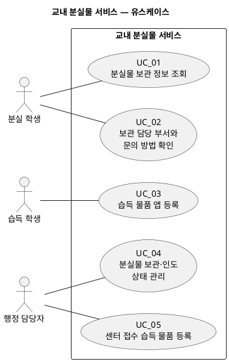

# 유스케이스 명세서 v0.2 — 교내 분실물 서비스

## 확정 사항

액터(시스템과 직접 상호작용하는 역할)는 **분실 학생, 습득 학생, 행정 담당자**의 3명이다. 유스케이스(사용자가 하나의 목표를 달성하는 서비스)는 화면·버튼·DB 저장 단계로 나누지 않는다.

| 구분 | 확정 내용 | 출처와 적용 |
| --- | --- | --- |
| 액터 | 분실 학생 / 습득 학생 / 행정 담당자 | 고객 검토 완료 지시; 원문 §2, S1·S2·S3 |
| 학생 등록 | 습득 학생이 주운 물품을 앱으로 바로 등록한다. | 고객 검토 완료 지시; FR_04, UC_03. 원문 S3만으로 등록 기능을 도출한 것은 아니다. |
| 센터 등록 | 행정 담당자가 분실물 센터에 접수된 습득 물품을 관리하려고 등록한다. | 고객 검토 완료 지시; NEEDS_2·SC2·S2; FR_07, UC_05 |
| 모델링 판단 | 학생 앱 등록과 센터 접수 등록을 별도 UC로 모델링한다(분석 결정; 고객 검토 완료 사항과 구분). | 주체·시작 상황·목표가 다름. 화면이나 저장 기능의 차이 때문이 아니다. [논의] Q_05: 입력·처리 차이가 없다면 하나의 UC에 두 액터를 연결하는 안을 재검토한다. |

기준: [고객 요구사항 원문](./고객%20요구사항.md) 및 [SRS_v0.2.md](./SRS_v0.2.md). [UC_v0.1.md](./UC_v0.1.md)의 액터 목록·UC 목록·다이어그램은 그대로 가져왔다.

## 액터 목록

| 액터 | 설명 | 주요 목표 | 근거 FR |
| --- | --- | --- | --- |
| 분실 학생 | 분실한 물품 정보를 확인하는 역할. | 방문 전 보관 여부·위치·문의 방법 파악 | FR_01, FR_02, FR_03, FR_06; 원문 S1·NEEDS_1·NEEDS_4 |
| 습득 학생 | 주운 물품을 앱으로 바로 등록하는 역할. | 습득 물품을 알려 반환을 위한 정보 제공 | FR_04; 고객 검토 완료 지시. 원문 S3·NEEDS_5는 맡길 장소 목표만 제시 |
| 행정 담당자 | 센터 접수 습득 물품을 등록하고 보관·인도 상태를 관리하는 역할. | 센터 물품 정보와 실제 처리 결과 관리 | FR_05, FR_06, FR_07; S2·NEEDS_2·NEEDS_3 및 고객 검토 완료 지시 |

정보보호 담당자·학생회·운영 책임자는 원문 §2의 이해관계자(요구에 의견·책임을 가진 사람)이다. 직접 시스템을 이용하는 서비스가 원문에 없고 확정 액터가 3명이므로 액터로 추가하지 않는다. 같은 학생이 상황에 따라 분실 학생과 습득 학생 역할을 맡을 수 있다.

## 유스케이스 목록

| UC ID | 유스케이스명 | 주 액터 | 사용자 목표 | 관련 FR·Pol |
| --- | --- | --- | --- | --- |
| UC_01 | 분실물 보관 정보 조회 | 분실 학생 | 방문 전 보관 여부·위치·상태를 확인해 반복 방문을 줄인다. | FR_01, FR_02, FR_06; Pol_01, Pol_02, Pol_03, Pol_04, Pol_08 |
| UC_02 | 보관 담당 부서와 문의 방법 확인 | 분실 학생 | 담당 창구와 문의 방법을 알아 올바른 부서로 문의한다. | FR_03; Pol_01, Pol_02, Pol_03, Pol_04 |
| UC_03 | 습득 물품 앱 등록 | 습득 학생 | 주운 물품을 앱으로 바로 알려 반환을 위한 정보를 제공한다. 센터 입고 완료를 의미하지 않는다. | FR_04; Pol_01, Pol_02, Pol_05, Pol_06, Pol_07 |
| UC_04 | 분실물 보관·인도 상태 관리 | 행정 담당자 | 실제 보관·인도 처리 결과를 기록하고 상태를 구분한다. | FR_05, FR_06; Pol_01, Pol_02, Pol_07, Pol_08, Pol_09, Pol_10 |
| UC_05 | 센터 접수 습득 물품 등록 | 행정 담당자 | 센터에 접수된 물품을 등록하여 보관 물품을 관리한다. | FR_07; Pol_01, Pol_02, Pol_05, Pol_06, Pol_07 |

## 등록 주체와 서비스 구분의 해석

원문 NEEDS_2의 **“행정 담당자는 필요한 물품 정보를 등록할 수 있어야 한다.”**, §1의 **“행정 담당자가 필요한 물품 정보를 등록하고 보관 중인 물품과 인도 완료 물품을 구분한다.”**는 행정 담당자의 등록 업무를 명시한다. 따라서 SC2의 ‘분실물 정보 등록’을 습득 학생만의 업무로 읽으면 안 된다. S3은 맡길 장소 안내 요구이므로 학생 앱 등록의 직접 근거로 사용하지 않았다. 학생 앱 등록과 센터 접수 맥락은 고객 검토 완료 지시에서 반영했다.

UC_03은 주운 학생의 즉시 등록, UC_05는 접수된 물품의 센터 관리 등록이라는 서로 다른 시작 상황과 사용자 목표를 가진다. 이 때문에 별도 서비스로 모델링한다. 하나의 ‘습득물 등록’ UC에 두 액터를 연결하는 대안도 가능하다. [논의] Q_05: 실제 업무 차이가 없다고 확인되면 공통 UC로 통합할지 재검토한다. 별도 UC라는 판단이 별도 화면·DB·앱 구현을 강제하지 않는다.

## 유스케이스 다이어그램

시스템 경계(서비스가 담당하는 범위)는 rectangle로 표시한다. 실선은 액터가 사용하는 서비스와의 연결이다. include(항상 재사용하는 다른 UC 호출)·extend(조건부로 추가하는 UC 실행)는 원문이 요구하는 관계가 없어 사용하지 않았다. UC_02가 반드시 UC_01 이후에만 실행된다는 제한도 원문에 없어 넣지 않는다. 사진 매칭·자동 알림은 제외하고, 맡길 장소 안내는 미정이므로 다이어그램 밖에서 질문으로 관리한다. 문법 참고: [PlantUML 공식 유스케이스 문서](https://plantuml.com/use-case-diagram).

## 유스케이스 명세의 전제

아래 표의 ‘액터 → 시스템 / 시스템 → 액터’는 상호작용 방향이다. 번호는 한 서비스 안의 단계이며 별도 유스케이스가 아니다. **[가정] 기본 흐름의 구체적 주고받기 순서와 실패·취소 시 보존 방식은 목표를 설명하기 위한 설계 제안**이다. 고객이 확정한 화면·입력·저장 구현이라는 뜻이 아니며 Q_04·Q_07·Q_08로 확인한다. 성공 흐름은 필요한 미정 기준이 합의됐다고 가정하고 설명한다. 이 가정은 현재 합의 완료를 뜻하지 않는다.

대안 흐름은 ‘분기 지점 > 조건 > 대응 > 복귀 또는 종료’로 적는다. 원문에 없는 대응은 [가정][논의]로 표시한다. 미정 정책 관련 분기는 검토용이며 현재 실행 요구가 아니다. 실패·취소는 성공과 구분하고 기존 데이터·임시 입력·완료 여부 불명 상태의 보존을 따로 기록한다.

### UC_01 — 분실물 보관 정보 조회

| 항목 | 내용 |
| --- | --- |
| ID / 이름 | UC_01 / 분실물 보관 정보 조회 |
| 사용자와 목표 | 분실 학생이 보관 여부·위치·공개 가능한 상태를 확인하여 방문 전 정보를 얻고 반복 방문을 줄인다. |
| 관련 고객 요구·정책 ID | FR_01, FR_02, FR_06 / NFR_01, NFR_03, NFR_04, NFR_05, NFR_06, NFR_07(후보) / Pol_01, Pol_02, Pol_03, Pol_04, Pol_08(후보). 원문 S1·SC1·NEEDS_1·NEEDS_3·NEEDS_6. |
| 사전 조건 / 시작 사건 | 사전 조건(서비스 시작 전에 충족해야 할 상황): 가상 물품 데이터로 조회를 시연할 수 있다. 등록 물품이 0개여도 조회 요청은 가능하다. 공개 항목은 합의 필요(Q_02). 시작: 학생이 방문 전에 물품을 찾으려고 조회를 요청한다. 로그인·학교 인증을 요구하지 않는다. |
| 기본 흐름 | 1. 분실 학생 → 시스템: 보관 정보 조회를 요청한다. 시스템 → 분실 학생: 조회 방법을 안내한다(조건은 Q_01). 2. 분실 학생 → 시스템: 조회 기준을 제시한다. 시스템 → 분실 학생: 등록 정보에서 해당 결과를 제공한다. 3. 분실 학생 → 시스템: 찾으려는 물품의 정보 확인을 요청한다. 시스템 → 분실 학생: 공개 가능한 보관 여부·위치·상태를 제공한다. 4. 분실 학생 → 시스템: 확인 완료를 알린다. 시스템 → 분실 학생: 조회를 마친다. |
| 대안·예외 흐름 | 2 > 조건이 유효하지 않음 > [가정][논의] 조건 보완을 안내 > 2로 복귀. Q_01: 필수 검색 조건을 논의한다. 2 > 일치 결과 없음 > [가정][논의] 등록 정보에서 결과를 찾지 못했다고 안내 > 종료 또는 2로 복귀. Q_01: 실제 미보관으로 단정하지 않는 문구를 논의한다. 3 > 이미 인도 완료 물품 > [논의] 인도 완료 표시·노출 수준은 Q_02의 합의에 따름 > 4로 복귀 또는 종료. 인도 완료 공개 여부를 논의한다. 3 > 보관 기간 만료가 확인됨 > [논의] Pol_08의 기간·처리·조회 규칙이 없어 응답 미확정 > Q_11 결정 후 3으로 복귀 또는 종료. 자동 폐기·상태 변경은 도입하지 않는다. 3 > 공개 불가 정보 포함 > Pol_03에 따라 개인 번호 비공개, 나머지는 [논의] Pol_04 적용 > 4로 복귀. Q_02의 허용 항목을 논의한다. 1~3 > 사용자가 중도 취소 > [가정][논의] 조회 종료, 기존 물품 정보 보존 > 종료. Q_08: 조회 중 임시 조건 보존 여부를 논의한다. |
| 사후 조건 | 성공: 합의된 공개 범위에서 결과를 확인하며 조회가 기존 물품 정보를 변경하지 않는다. [가정] 조회를 읽기 서비스로 설계. 실패·취소: 기존 물품 정보 보존. 검색 조건·조회 기록 보존은 미정(Q_08)이며 새로운 물품 정보를 만들지 않는다. |
| 미확정 사항·고객 질문 | Q_01, Q_02, Q_08, Q_09, Q_11. [논의] 검색·공개 범위·품질 평가·보존·만료 규칙은 공통 질문 표를 따른다. |

### UC_02 — 보관 담당 부서와 문의 방법 확인

| 항목 | 내용 |
| --- | --- |
| ID / 이름 | UC_02 / 보관 담당 부서와 문의 방법 확인 |
| 사용자와 목표 | 분실 학생이 보관 담당 부서와 문의 방법을 확인하여 올바른 창구에 문의할 수 있게 한다. |
| 관련 고객 요구·정책 ID | FR_03 / NFR_01, NFR_03, NFR_05, NFR_06 / Pol_01, Pol_02, Pol_03, Pol_04. 원문 NEEDS_4·SC6·S4·SC8. |
| 사전 조건 / 시작 사건 | 가상 문의 정보로 시연 가능하며 표시 항목은 Q_03에서 합의 필요. UC_01 수행 완료를 필수로 두지 않는다. 시작: 학생이 담당 부서와 문의 방법을 알아보려 한다. |
| 기본 흐름 | 1. 분실 학생 → 시스템: 문의 방법 안내를 요청한다. 시스템 → 분실 학생: 담당 부서·문의 정보의 확인 맥락을 안내한다. 2. 분실 학생 → 시스템: 필요한 담당 창구 확인을 요청한다. 시스템 → 분실 학생: 공개 가능한 담당 부서와 문의 방법을 제공한다. 3. 분실 학생 → 시스템: 안내 확인을 완료한다. 시스템 → 분실 학생: 안내를 마친다. 실제 문의·연락은 서비스 밖의 행동이다. |
| 대안·예외 흐름 | 2 > 담당 부서·문의 정보 누락 > [가정][논의] 정보 미등록 사실을 안내 > 종료. Q_03: 대체 안내와 관리 책임을 논의한다. 2 > 개인 휴대전화 번호 포함 > Pol_03에 따라 번호를 비공개 > 3으로 복귀. 나머지 문의 정보의 공개 수준은 [논의] Q_03에서 정한다. 1~2 > 사용자가 중도 취소 > [가정][논의] 안내 종료, 기존 정보 보존 > 종료. Q_08: 임시 선택 정보 보존을 논의한다. |
| 사후 조건 | 성공: 담당 부서와 합의된 문의 방법을 확인한다. [가정] 안내가 물품·문의 원본을 변경하지 않는다. 실패·취소: 기존 데이터 보존. 대체 정보 표시·임시 선택 보존은 Q_03·Q_08에서 결정. 문의 메시지는 이 UC에서 전송하지 않는다. |
| 미확정 사항·고객 질문 | Q_03, Q_08, Q_09. [논의] 문의 항목·누락 안내·사용성 측정 방식 확인. |

### UC_03 — 습득 물품 앱 등록

| 항목 | 내용 |
| --- | --- |
| ID / 이름 | UC_03 / 습득 물품 앱 등록 |
| 사용자와 목표 | 습득 학생이 주운 물품을 등록하여 반환을 위한 물품 정보를 제공한다. |
| 관련 고객 요구·정책 ID | FR_04 / NFR_02, NFR_03, NFR_04, NFR_05, NFR_06 / Pol_01, Pol_02, Pol_05, Pol_06, Pol_07. 고객 검토 완료 지시의 앱 등록. SC2는 등록 범위 참고; S3·SC4는 맡길 장소 요구. |
| 사전 조건 / 시작 사건 | 가상 물품 데이터를 사용한다. 습득 학생이 물품을 주운 상황이며 센터 접수 완료를 전제하지 않는다. 역할별 세부 권한·검증 방법은 Q_06에서 확인. 시작: 습득 학생이 주운 물품의 등록을 요청한다. |
| 기본 흐름 | 1. 습득 학생 → 시스템: 물품 등록을 요청한다. 시스템 → 습득 학생: 등록에 필요한 정보 항목을 안내한다(항목은 Q_04). 2. 습득 학생 → 시스템: 가상 물품 정보를 제공한다. 시스템 → 습득 학생: 입력 정보와 확인 결과를 제시한다. 3. 습득 학생 → 시스템: 등록 의사를 확정해 요청한다. 시스템 → 습득 학생: 합의된 입력 기준을 검토한다. 4. 습득 학생 → 시스템: 등록 요청을 유지한다. 시스템 → 습득 학생: 등록 결과를 알린다. DB 저장은 이 서비스의 내부 단계이며 별도 UC가 아니다. |
| 대안·예외 흐름 | 3 > 필수 정보 누락 > [가정][논의] 누락 항목 안내와 보완 요청 > 2로 복귀. Q_04·Q_08: 필수 항목과 보완 방식을 논의한다. 3 > 다른 등록 경로에 같은 물품이 있을 가능성 > [논의] 중복 판단·기존 기록 연결·수정·새 등록 여부 미정 > Q_05 결정 후 2로 복귀 또는 종료. 자동 중복 탐지 기능을 확정하지 않는다. 4 > 저장 실패 또는 완료 여부 불명 > [가정][논의] 결과 미확정 안내, 기존 정상 데이터 보존을 제안 > 3 재시도 또는 종료. Q_08: 재시도 중복과 임시 입력 보존을 논의한다. 1~3 > 사용자가 중도 취소 > [가정][논의] 새 등록 완료 없이 종료, 기존 데이터 보존 > 종료. Q_08: 입력값 보존·삭제를 논의한다. 2 > 사진 업로드 실패를 고려 > 현재 모델에 사진 첨부가 없어 실행 분기 없음. [논의] Q_14에서 일반 사진 첨부를 포함하면 필수 여부·재시도·사진 없이 등록 가능 여부를 정한 뒤 2로 복귀 또는 종료 흐름을 추가한다. 사진 기반 매칭은 Pol_05에 따라 제외. |
| 사후 조건 | 성공: 합의된 항목의 가상 물품 등록 기록이 생성된다. 학생 등록만으로 센터 보관 완료·인도 권한·즉시 공개를 확정하지 않는다(Q_04·Q_06). 실패·취소: [가정] 기존 정상 기록 보존, 취소는 새 등록을 완료하지 않는다. 저장 실패의 부분 저장·완료 불명 결과와 임시 입력 보존은 Q_08에서 결정한다. |
| 미확정 사항·고객 질문 | Q_04, Q_05, Q_06, Q_08, Q_09, Q_10, Q_14. [논의] 항목·공개 시점·중복·권한·실패 보존·사진 범위·맡길 장소 안내 포함 여부 확인. |

### UC_04 — 분실물 보관·인도 상태 관리

| 항목 | 내용 |
| --- | --- |
| ID / 이름 | UC_04 / 분실물 보관·인도 상태 관리 |
| 사용자와 목표 | 행정 담당자가 실제 보관·인도 결과를 기록하고 두 상태를 구분하여 이미 인도한 물품을 잘못 안내하는 문제를 줄인다. |
| 관련 고객 요구·정책 ID | FR_05, FR_06 / NFR_03, NFR_04, NFR_05, NFR_06 / Pol_01, Pol_02, Pol_07, Pol_08(후보), Pol_09(후보), Pol_10(후보). 원문 NEEDS_3·SC3·S2. |
| 사전 조건 / 시작 사건 | 관리 대상 가상 물품이 등록되어 있다. 주 액터는 행정 담당자이며 세부 변경·정정 권한의 시연 방식은 Q_06에서 확인한다. 시작: 행정 담당자가 보관·인도 처리 결과를 기록하려 한다. 물리적 인도·소유 확인이 시스템 기능이라고 전제하지 않는다. |
| 기본 흐름 | 1. 행정 담당자 → 시스템: 대상 물품의 상태 관리를 요청한다. 시스템 → 행정 담당자: 대상 물품과 현재 기록 상태를 제공한다. 2. 행정 담당자 → 시스템: 실제 업무 결과에 맞는 보관 중 또는 인도 완료 기록을 요청한다. 시스템 → 행정 담당자: 변경할 상태의 확인 내용을 제공한다. 3. 행정 담당자 → 시스템: 상태 기록을 확정해 요청한다. 시스템 → 행정 담당자: 합의된 변경 조건을 확인하고 결과를 알린다(조건은 Q_06·Q_07). 4. 행정 담당자 → 시스템: 갱신 결과의 확인을 요청한다. 시스템 → 행정 담당자: 보관 중과 인도 완료를 구분하여 제공한다. |
| 대안·예외 흐름 | 1 > 대상 물품이 없음 > [가정][논의] 대상 부재 안내 > 1로 복귀 또는 종료. Q_08: 오류 안내 방식을 논의한다. 2~3 > 필수 처리 정보 누락 > [가정][논의] 누락 정보 보완 요청 > 2로 복귀. Q_07·Q_08: 상태 기록에 필요한 정보를 논의한다. 2~3 > 이미 인도 완료된 물품의 재처리·정정 요청 > [논의] 허용 여부·권한·근거·이력 미정 > Q_07 결정 후 2로 복귀 또는 종료. 자동 재인도를 확정하지 않는다. 2~3 > 보관 기간 만료 물품 > [논의] 기간·만료 뒤 인도 가능 여부·처리 미정 > Q_11 결정 후 2로 복귀 또는 종료. 만료 상태·폐기 기능을 추가하지 않는다. 2~3 > 물리적 인도 과정에서 본인 확인 실패가 전달됨 > [가정][논의] 인도 완료 기록을 보류하고 기존 기록을 유지하는 안 > 종료 또는 2로 복귀. Q_12: 확인 담당·방법·실패 시 처리·기록을 논의한다. 새 본인 인증 UC를 만들지 않는다. 2~3 > 두 사람이 같은 물품을 자기 것이라고 주장 > [가정][논의] 인도 완료 기록 보류와 기존 기록 유지의 안 > 종료 또는 2로 복귀. Q_13: 판정 주체·근거·상태·기록을 논의한다. 3 > 상태 저장 실패·완료 여부 불명 > [가정][논의] 실패 결과 안내 및 기존 정상 상태 보존 제안 > 3 재시도 또는 종료. Q_08: 재확인·부분 변경·재시도 방식 논의. 1~3 > 사용자가 중도 취소 > [가정][논의] 변경 미완료, 기존 기록 보존 > 종료. Q_08: 미완료 정보 보존 방식 논의. |
| 사후 조건 | 성공: 합의된 조건에 따라 보관 중 또는 인도 완료 상태가 기록되고 두 상태를 구분한다. 상세 인도·소유 확인 이력의 저장을 확정하지 않는다. 실패·취소: [가정] 기존 정상 상태 보존. 완료 여부 불명의 재확인·부분 변경 처리·임시 입력·정정 이력 보존은 Q_07·Q_08에서 결정. |
| 미확정 사항·고객 질문 | Q_06, Q_07, Q_08, Q_11, Q_12, Q_13. [논의] 권한·정정·기간·본인 확인·분쟁 처리는 질문 표를 따른다. |

### UC_05 — 센터 접수 습득 물품 등록

| 항목 | 내용 |
| --- | --- |
| ID / 이름 | UC_05 / 센터 접수 습득 물품 등록 |
| 사용자와 목표 | 행정 담당자이 센터에 접수된 물품을 등록하여 센터 보관 물품을 관리한다. |
| 관련 고객 요구·정책 ID | FR_07 / NFR_02, NFR_03, NFR_04, NFR_05, NFR_06 / Pol_01, Pol_02, Pol_05, Pol_06, Pol_07. 원문 NEEDS_2·S2·SC2와 고객 검토 완료 지시의 센터 접수 등록. |
| 사전 조건 / 시작 사건 | 가상 물품 데이터를 사용한다. 센터에 물품이 접수된 상황이다. 학생 앱 등록을 필수 선행으로 요구하지 않는다. 역할별 세부 권한·검증 방법은 Q_06에서 확인. 시작: 행정 담당자이 센터에 접수된 물품의 등록을 요청한다. |
| 기본 흐름 | 1. 행정 담당자 → 시스템: 물품 등록을 요청한다. 시스템 → 행정 담당자: 등록에 필요한 정보 항목을 안내한다(항목은 Q_04). 2. 행정 담당자 → 시스템: 가상 물품 정보를 제공한다. 시스템 → 행정 담당자: 입력 정보와 확인 결과를 제시한다. 3. 행정 담당자 → 시스템: 등록 의사를 확정해 요청한다. 시스템 → 행정 담당자: 합의된 입력 기준을 검토한다. 4. 행정 담당자 → 시스템: 등록 요청을 유지한다. 시스템 → 행정 담당자: 등록 결과를 알린다. DB 저장은 이 서비스의 내부 단계이며 별도 UC가 아니다. |
| 대안·예외 흐름 | 3 > 필수 정보 누락 > [가정][논의] 누락 항목 안내와 보완 요청 > 2로 복귀. Q_04·Q_08: 필수 항목과 보완 방식을 논의한다. 3 > 다른 등록 경로에 같은 물품이 있을 가능성 > [논의] 중복 판단·기존 기록 연결·수정·새 등록 여부 미정 > Q_05 결정 후 2로 복귀 또는 종료. 자동 중복 탐지 기능을 확정하지 않는다. 4 > 저장 실패 또는 완료 여부 불명 > [가정][논의] 결과 미확정 안내, 기존 정상 데이터 보존을 제안 > 3 재시도 또는 종료. Q_08: 재시도 중복과 임시 입력 보존을 논의한다. 1~3 > 사용자가 중도 취소 > [가정][논의] 새 등록 완료 없이 종료, 기존 데이터 보존 > 종료. Q_08: 입력값 보존·삭제를 논의한다. 2 > 사진 업로드 실패를 고려 > 현재 모델에 사진 첨부가 없어 실행 분기 없음. [논의] Q_14에서 일반 사진 첨부를 포함하면 필수 여부·재시도·사진 없이 등록 가능 여부를 정한 뒤 2로 복귀 또는 종료 흐름을 추가한다. 사진 기반 매칭은 Pol_05에 따라 제외. |
| 사후 조건 | 성공: 합의된 항목의 가상 물품 등록 기록이 생성된다. 초기 보관 상태·위치·공개 시점은 Q_04의 합의에 따른다. 실패·취소: [가정] 기존 정상 기록 보존, 취소는 새 등록을 완료하지 않는다. 저장 실패의 부분 저장·완료 불명 결과와 임시 입력 보존은 Q_08에서 결정한다. |
| 미확정 사항·고객 질문 | Q_04, Q_05, Q_06, Q_08, Q_09, Q_10, Q_14. [논의] 항목·공개 시점·중복·권한·실패 보존·사진 범위·맡길 장소 안내 포함 여부 확인. |

## 요청한 예외 상황 검토표

| 검토 대상 | 적용·검토 위치 | 확정 여부 |
| --- | --- | --- |
| 필수 정보 누락 | UC_03·UC_05의 3, UC_04의 2~3; Q_04·Q_07·Q_08 | 필수 항목·보완 방식 미정 |
| 사진 업로드 실패 | UC_03·UC_05의 2; Pol_05·Q_14 | 사진 첨부 자체가 미확정. 현재 실행 분기 없음 |
| 이미 수령된 물품 | UC_01의 3, UC_04의 2~3; Q_02·Q_07 | 인도 완료 구분은 확정, 공개·재처리는 미정 |
| 보관 기간 만료 | UC_01의 3, UC_04의 2~3; Pol_08·Q_11 | 기간과 만료 처리 미정 |
| 본인 확인 실패 | UC_04의 2~3; Pol_09·Q_12 | 물리적 인도 관련 조건; 시스템 기능 여부 미정 |
| 복수 소유 주장 | UC_04의 2~3; Pol_10·Q_13 | 판정·보류·기록 방식 미정 |
| 사용자 중도 취소 | UC_01~UC_05 모두; Q_08 | 기존 데이터 보존은 가정, 임시 입력 보존 미정 |

## 질문 사항

번호는 5개 문서에서 공통으로 쓰며 동일 질문의 반복은 새 질문이 아니다.

| 번호 | 질문 | 관련 ID | 질문 이유 |
| --- | --- | --- | --- |
| Q_01 | [논의] 어떤 검색 조건과 결과 없음 안내가 필요한가? | FR_01, UC_01 | SC1 검색 조건 미정. 결과 없음이 실제 미보관을 뜻하는지 단정할 수 없음. |
| Q_02 | [논의] 위치·상태·물품 상세의 공개 항목은 무엇이며 인도 완료 물품도 학생에게 보이는가? | FR_02, FR_06, NFR_03, Pol_04, UC_01 | SC1·NEEDS_6 공개 범위 미정; 학생 상태 조회 해석 확인. |
| Q_03 | [논의] 담당 부서와 문의 방법으로 어떤 정보를 표시하며 누가 공개 범위를 검토·승인하는가? 정보 누락 시 안내는? | FR_03, Pol_03, Pol_04, UC_02 | SC6 표시 내용·S4 검토 사항 미정. 직접 연락 전송을 임의 도입하지 않기 위함. |
| Q_04 | [논의] 학생 앱 등록과 센터 등록의 필수·선택 항목은 무엇이며 학생 등록의 보관 위치·초기 상태·공개 시점은 어떻게 정하는가? | FR_04, FR_07, Pol_07, UC_03, UC_05 | SC2 필수 항목 미정; 앱 등록을 센터 보관 완료와 혼동하지 않기 위함. |
| Q_05 | [논의] 두 등록의 업무 차이와 중복 물품 연결·수정 기준은 무엇인가? 별도 UC 모델을 유지할 필요가 있는가? | FR_04, FR_07, Pol_07, UC_03, UC_05 | 두 등록 주체는 확정. 처리 차이·중복 처리·하나의 UC 대안은 미정. |
| Q_06 | [논의] 등록·상태 변경·정정의 세부 권한과 학교 인증 없는 역할 시연 방법은 무엇인가? | FR_04, FR_05, FR_07, NFR_06, Pol_02, Pol_07, UC_04 | SC2·SC3 권한 미정; C_1 학교 인증 제외. 학생의 상태 변경 권한을 임의 부여하지 않음. |
| Q_07 | [논의] 인도 완료 기록의 조건·정정 절차·이미 인도된 물품의 재처리·이력 보존 기준은 무엇인가? | FR_05, FR_06, Pol_07, UC_04 | SC3 처리·정정 조건 미정. 자동 반려·상태 되돌리기를 확정하지 않음. |
| Q_08 | [논의] 필수 정보 누락·저장 실패·중도 취소 시 재시도와 임시 입력·기존 데이터의 보존 기준은 무엇인가? | FR_04, FR_05, FR_07, NFR_04, Pol_07, UC_03, UC_04, UC_05 | 원문에 오류·취소 규칙 없음. 명세의 보존 가정 승인 필요. |
| Q_09 | [논의] 등록 부담의 원인·현행 측정값·개선 목표 및 사용성·응답시간 평가 조건과 합격선은 무엇인가? | NFR_01, NFR_02, NFR_04, NFR_07, UC_01, UC_03, UC_05 | §1·NEEDS_7 수치 미정. 9/10 등 검토 제안과 고객 확정값을 구분. |
| Q_10 | [논의] 맡길 장소 안내를 프로그램에 포함하는가? 기존 안내와 운영 책임자는 누구인가? | Pol_06, UC_03, UC_05(맥락 관련) | SC4·NEEDS_5 미정; §2 운영 책임자 확인 필요. 포함 승인 전 새 FR·UC를 만들지 않음. |
| Q_11 | [논의] 보관 기간·기산일·만료 판단과 이후 물품 처리·조회 방식은 무엇인가? | Pol_08, UC_01, UC_04 | 원문에 기간·만료 규칙 없음. 과제의 만료 예외 검토를 위한 질문. |
| Q_12 | [논의] 물품 본인 확인·수령 절차와 확인 실패 시 처리·기록은 무엇인가? | Pol_09, UC_04 | NEEDS_3은 상태 기록만 요구. 물리적 인도와 시스템 본인 인증 기능을 구분. |
| Q_13 | [논의] 같은 물품을 두 사람이 주장하면 누가 무엇으로 판단하며 시스템 기록·상태 반영이 필요한가? | Pol_10, UC_04 | 원문에 분쟁 규칙 없음. 과제 예외 검토를 위한 질문. |
| Q_14 | [논의] 일반 등록 사진 첨부도 제외하는가? 포함한다면 필수 여부·용량·실패 시 처리 기준은 무엇인가? | Pol_05, FR_04, FR_07, UC_03, UC_05 | SC5는 사진 기반 유사 조회 제외. 별도 사진 첨부 포함을 확정하지 않음. |
| Q_15 | [논의] 포함 기능의 구현 우선순위와 미정 정책의 승인 책임자는 누구인가? | FR_01, FR_02, FR_03, FR_04, FR_05, FR_06, FR_07 | 높음은 분석자 제안; §2 운영 책임자 확인 필요. |
